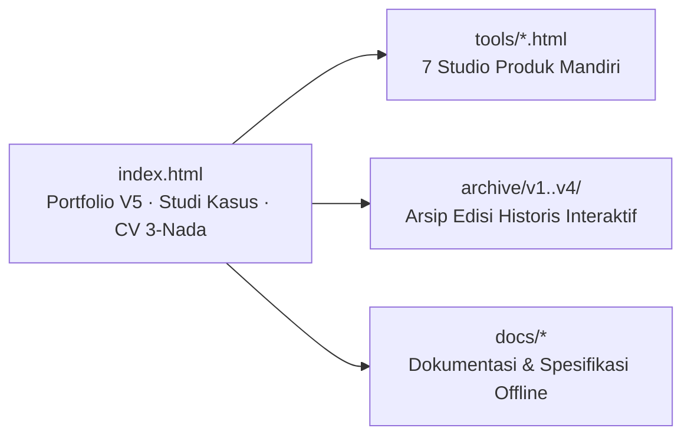

<div align="center">
  <picture>
    <source media="(prefers-color-scheme: dark)" srcset="./assets/readme-header-dark.svg" />
    <source media="(prefers-color-scheme: light)" srcset="./assets/readme-header-light.svg" />
    
  </picture>

  <p>
    <a href="./README.md">← English</a> · <strong>Bahasa Indonesia</strong>
    &nbsp;&nbsp;·&nbsp;&nbsp;
    <a href="https://alamehan.github.io/"><strong>✨ Buka Live Portfolio</strong></a> ·
    <a href="https://github.com/alamehan/mehan-design-system">Mehan Design System</a> ·
    <a href="https://github.com/alamehan/mehan-skills">Mehan Skills</a>
  </p>
</div>

> ✨ Portofolio personal interaktif, rangkaian studio aplikasi single-HTML & studi kasus — crafted by @alamehan
>
> `portfolio` `product-design` `design-engineering` `design-system` `web-apps` `interactive-ui` `case-studies`

---

## Selamat Datang di Portfolio V5 (`@alamehan`)

Kebanyakan portofolio hanya *menceritakan* proses desain dan rekayasa lewat tangkapan layar statis serta daftar poin singkat — sehingga perekrut, founder, maupun rekan kolaborator hanya bisa menebak bagaimana rasanya saat produk tersebut benar-benar diklik, dibuka lewat layar ponsel, diganti ke mode gelap, atau dipakai menyelesaikan pekerjaan nyata.

**Portfolio V5** mengajak pengunjung merasakan langsung kualitas itu di **[alamehan.github.io](https://alamehan.github.io/)** — dirancang dan dibangun oleh **[M. Raihan Rafiiful Allaam (`@alamehan`)](https://alamehan.github.io/)**. Selain enam bab narasi portofolio, bedah studi kasus mendalam, laci ringkasan CV adaptif 3-nada (*All-HR*, *Balanced*, *Specialist*), serta mesin waktu interaktif `V1 → V5`, situs ini menyajikan keluarga **studio produk siap pakai tanpa instalasi** — masing-masing dikemas dalam satu file `.html` mandiri yang langsung berjalan di browser modern tanpa akun, tanpa server, dan tanpa pelacak pihak ketiga.

---

## Jelajahi Sekarang

| Apa yang ingin kamu lakukan | Buka bagian ini |
|---|---|
| **Mencoba langsung Portfolio V5, studi kasus, CV 3-nada & aplikasi interaktif** | Kunjungi **[alamehan.github.io](https://alamehan.github.io/)** |
| **Menjelajahi design system UI & UX open-source mandiri di atas Meta Astryx** | Kunjungi **[Mehan Design System](https://github.com/alamehan/mehan-design-system)** *(atau [Buka Live Studio](https://alamehan.github.io/mehan-design-system/))* |
| **Mengambil playbook satu-file siap pakai untuk agen coding AI (`SKILL.md`)** | Kunjungi **[Mehan Skills](https://github.com/alamehan/mehan-skills)** |
| **Mengunduh & menjalankan studio 100% offline di perangkatmu sendiri** | Buka file `.html` mana pun di [`./tools/`](./tools) atau [`./index.html`](./index.html) |

---

## Keunggulan Utama

- **Portofolio yang Benar-Benar Bisa Dipakai Kerja:** Jelajahi rangkaian aplikasi utuh lewat empat tampilan katalog yang tersinkronisasi otomatis (*Cards*, *Table*, *Deck*, dan *Orbit*) — mulai dari pemetaan pengetahuan, olah konten editorial, peracik CV & karier, dek presentasi, storyboard visual, strategi produk, hingga animator diagram.
- **Menyesuaikan Gaya Pembaca (`All-HR · Balanced · Specialist`):** Baik pembaca yang hanya punya waktu dua menit melihat dampak bisnis maupun rekan teknis yang ingin menyelami detail arsitektur, laci resume eksekutif dan antarmuka 2 bahasa (`ID`/`EN`) menyesuaikan dalam satu klik.
- **Satu File Mandiri, Siap Offline & Terjaga Privasinya:** Setiap aplikasi di [`./tools/`](./tools) mengemas sendiri permukaan taktil *Porcelain SaaS*, font open-source bawaan (`Bricolage Grotesque`, `Figtree`, `Geist Mono`), dan penyimpanan murni di perangkat — seluruh pekerjaanmu tetap aman di browser sendiri.
- **Sentuhan Hangat & Mesin Waktu `V1–V5`:** Menyimpan arsip edisi **Portfolio `V1` hingga `V4`** di [`./archive/`](./archive) yang tetap bisa dimainkan lewat terminal rahasia **`@alamehan · Console`** bersama dua kucing piksel *Ema & Ogo*.

---

## Daftar Studio & Gambaran Teknis

<details>
<summary><strong>🚀 Ketujuh Studio Aplikasi Single-HTML Siap Pakai</strong></summary>

Setiap studio di bawah dapat dijalankan langsung lewat web maupun 100% offline dengan mengunduh satu file `.html`-nya dari [`./tools/`](./tools):

| Studio | Fokus Utama | Tautan Langsung |
|---|---|---|
| **OmniGraph** | Peta Pengetahuan & Penjelajah Tujuh Ranah dengan pembaca multibahasa & ekspor PDF editorial | [Buka OmniGraph](https://alamehan.github.io/tools/omnigraph.html) |
| **ContentOS** | Ruang Kerja Olah Konten lintas 8 rumpun MECE & 66 alur kerja terstruktur | [Buka ContentOS](https://alamehan.github.io/tools/contentos.html) |
| **CareerOS** | Studio Master CV & Peracik Resume PDF sesuai peran dengan pengukur halaman real-time | [Buka CareerOS](https://alamehan.github.io/tools/careeros.html) |
| **SuperDocs** | Studio Etalase Produk, Dek Presentasi & Brand Kit Interaktif lengkap dengan Present Mode | [Buka SuperDocs](https://alamehan.github.io/tools/superdocs.html) |
| **SuperStudio** | Studio DNA Gaya Visual, Blueprint Storyboard & Perakit Prompt Gambar Deterministik | [Buka SuperStudio](https://alamehan.github.io/tools/superstudio.html) |
| **BizPackage** | Studio Strategi Produk, Tangga Nilai & Paket Peluncuran Bisnis | [Buka BizPackage](https://alamehan.github.io/tools/bizpackage.html) |
| **Diagranimate** | Animator Flowchart Mermaid Progresif dengan kamera pegas & ekspor WebM/PNG 60fps | [Buka Diagranimate](https://alamehan.github.io/tools/diagranimate.html) |

</details>

<details>
<summary><strong>🏗️ Struktur Rilis Publik &amp; Arsitektur Offline</strong></summary>



```text
alamehan.github.io/
├── index.html          Portfolio V5 terpadu (ID/EN, Terang/Gelap, katalog 4-mode & CV 3-nada)
├── tools/              Aplikasi single-file HTML mandiri (omnigraph, contentos, careeros, ...)
├── docs/               Dokumen spesifikasi produk, alur pengguna & arsitektur teknis per studio
├── archive/            Museum interaktif offline Portfolio V1–V4 (+ V4 Tools)
├── assets/             Mockup visual portofolio (.webp) & banner header SVG 2.5D adaptif
└── REPORT.md           Laporan otomatis hasil kompilasi, ukuran file & verifikasi offline
```

- **Nol Ketergantungan Server Eksternal:** Setiap file `.html` menyertakan CSS, JavaScript, ikon, dan font `.woff2` berlisensi resmi di dalamnya sehingga langsung berjalan mulus baik lewat `https://` maupun klik dua kali `file://` tanpa internet.
- **Ekosistem Open-Source Pendamping:** Kunjungi **[Mehan Design System](https://github.com/alamehan/mehan-design-system)** untuk sistem komponen React/HTML/AI/Figma dan **[Mehan Skills](https://github.com/alamehan/mehan-skills)** untuk kumpulan playbook agen AI.

</details>

---

Dirancang dan dibangun sepenuh hati oleh **[M. Raihan Rafiiful Allaam (`@alamehan`)](https://alamehan.github.io/)** — *Product Designer & Product Engineer*.
