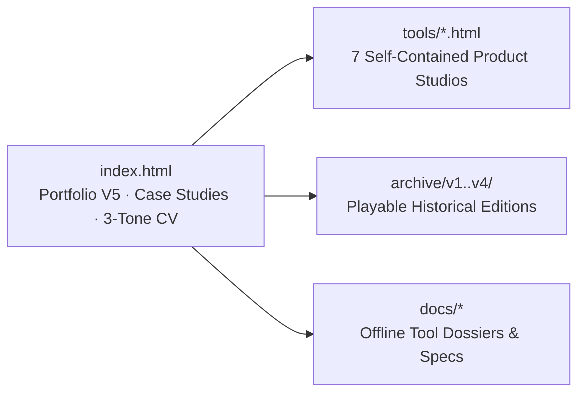

<div align="center">
  <picture>
    <source media="(prefers-color-scheme: dark)" srcset="./assets/readme-header-dark.svg" />
    <source media="(prefers-color-scheme: light)" srcset="./assets/readme-header-light.svg" />
    
  </picture>

  <p>
    <strong>English</strong> · <a href="./README.id.md">Bahasa Indonesia →</a>
    &nbsp;&nbsp;·&nbsp;&nbsp;
    <a href="https://alamehan.github.io/"><strong>✨ Visit Live Portfolio</strong></a> ·
    <a href="https://github.com/alamehan/mehan-design-system">Mehan Design System</a> ·
    <a href="https://github.com/alamehan/mehan-skills">Mehan Skills</a>
  </p>
</div>

> ✨ Interactive personal portfolio, single-HTML product studios & case studies — crafted by @alamehan
>
> `portfolio` `product-design` `design-engineering` `design-system` `web-apps` `interactive-ui` `case-studies`

---

## Welcome to Portfolio V5 (`@alamehan`)

Most portfolios only *describe* design and engineering through static screenshots and bullet points — leaving hiring managers, founders, and fellow builders to guess how an interface actually feels when clicked, resized on a phone, switched into dark mode, or put to real daily work.

**Portfolio V5** invites you to experience that craft firsthand at **[alamehan.github.io](https://alamehan.github.io/)** — designed and engineered by **[M. Raihan Rafiiful Allaam (`@alamehan`)](https://alamehan.github.io/)**. Alongside six narrative portfolio chapters, visual case-study deep dives, an adaptive 3-tone executive resume (*All-HR*, *Balanced*, *Specialist*), and a playable `V1 → V5` time-machine archive, this site hosts a family of **complete, zero-install product studios** — each delivered as a single self-contained `.html` file that runs in any modern browser with zero accounts, zero servers, and zero external tracking.

---

## Explore Right Now

| What you want to do | Where to go |
|---|---|
| **Experience Portfolio V5, case studies, 3-tone executive resume & interactive tools** | Visit **[alamehan.github.io](https://alamehan.github.io/)** |
| **Explore the standalone open-source UI & UX design system on Meta Astryx** | Visit **[Mehan Design System](https://github.com/alamehan/mehan-design-system)** *(or [Open Live Studio](https://alamehan.github.io/mehan-design-system/))* |
| **Grab portable single-file playbooks for AI coding agents (`SKILL.md`)** | Visit **[Mehan Skills](https://github.com/alamehan/mehan-skills)** |
| **Download & run any studio 100% offline on your own device** | Open any `.html` file in [`./tools/`](./tools) or [`./index.html`](./index.html) |

---

## Highlights

- **A Portfolio You Can Actually Use:** Browse real shipped product studios across four synchronized catalog views (*Cards*, *Table*, *Deck*, and *Orbit*) — covering knowledge mapping, editorial content workflows, career & resume tailoring, interactive slide decks, visual style storyboarding, venture packaging, and animated diagrams.
- **Tailored for Every Reader (`All-HR · Balanced · Specialist`):** Whether you have two minutes to scan business outcomes or want deep design-engineering specifics, the executive resume drawer and bilingual (`EN`/`ID`) interface adapt in one click.
- **Single-File, Offline-Ready & Private by Construction:** Every application in [`./tools/`](./tools) bundles its own *Porcelain SaaS* tactile surfaces, open-source typography (`Bricolage Grotesque`, `Figtree`, `Geist Mono`), and strict on-device storage — your work never leaves your browser.
- **Playful Craft & Living History:** Preserves curated, playable editions of **Portfolio `V1` through `V4`** in [`./archive/`](./archive), unlocked via the hidden **`@alamehan · Console`** alongside resident pixel cats *Ema & Ogo*.

---

## Shipped Studios & Technical Overview

<details>
<summary><strong>🚀 All 7 Live Single-HTML Product Studios</strong></summary>

Every studio below runs live on the web or 100% offline by downloading its single `.html` file from [`./tools/`](./tools):

| Studio | Focus | Live Link |
|---|---|---|
| **OmniGraph** | Knowledge Atlas & Seven Realms Explorer with multilingual reader & editorial PDF export | [Launch OmniGraph](https://alamehan.github.io/tools/omnigraph.html) |
| **ContentOS** | Universal Content Processing Workbench across 8 MECE families & 66 structured workflows | [Launch ContentOS](https://alamehan.github.io/tools/contentos.html) |
| **CareerOS** | Living Master CV & Role-Tailored PDF Resume Studio with real-time page-budget fit | [Launch CareerOS](https://alamehan.github.io/tools/careeros.html) |
| **SuperDocs** | Interactive Product Showcase, Slide Deck & Brand Kit Studio with Present Mode | [Launch SuperDocs](https://alamehan.github.io/tools/superdocs.html) |
| **SuperStudio** | Visual Style DNA, Storyboard Blueprint & Deterministic Image-Prompt Studio | [Launch SuperStudio](https://alamehan.github.io/tools/superstudio.html) |
| **BizPackage** | IP-to-Venture Strategy, Value Ladder & Launch Kit Studio | [Launch BizPackage](https://alamehan.github.io/tools/bizpackage.html) |
| **Diagranimate** | Progressive Mermaid Flowchart Animator with spring camera & 60fps WebM/PNG export | [Launch Diagranimate](https://alamehan.github.io/tools/diagranimate.html) |

</details>

<details>
<summary><strong>🏗️ Public Release Structure &amp; Offline Architecture</strong></summary>



```text
alamehan.github.io/
├── index.html          Unified Portfolio V5 (EN/ID, Light/Dark, 4-way studio catalog & 3-tone CV)
├── tools/              Self-contained single-file HTML studios (omnigraph, contentos, careeros, ...)
├── docs/               Offline product requirements, user flows & technical specs per studio
├── archive/            Curated offline Portfolio V1–V4 (+ V4 Tools) museum
├── assets/             Portfolio visual mockups (.webp) & adaptive 2.5D README header banners
└── REPORT.md           Automated build, size & offline smoke-verification report
```

- **Zero External Runtime Dependencies:** Every `.html` studio embeds its own CSS, JavaScript, icons, and licensed open-source `.woff2` fonts so it opens cleanly via `https://` or local `file://` double-click without internet access.
- **Open-Source Companion Ecosystem:** Explore **[Mehan Design System](https://github.com/alamehan/mehan-design-system)** for the reusable React/HTML/AI/Figma UI system and **[Mehan Skills](https://github.com/alamehan/mehan-skills)** for portable AI agent playbooks.

</details>

---

Designed and built with care by **[M. Raihan Rafiiful Allaam (`@alamehan`)](https://alamehan.github.io/)** — *Product Designer & Product Engineer*.
